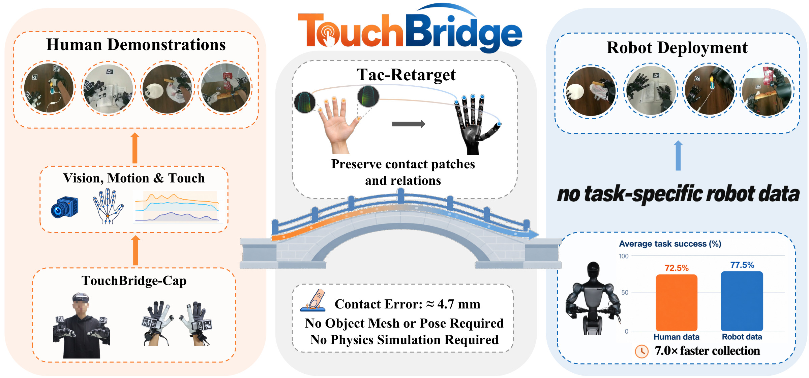
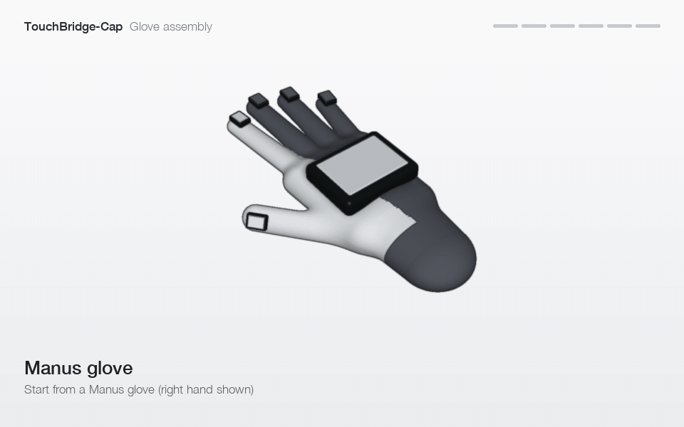
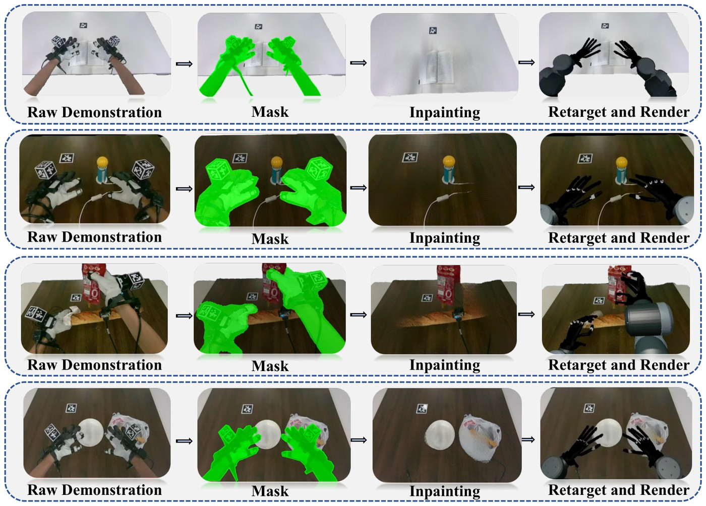

# TouchBridge

**Tactile-Conditioned Human-to-Robot Transfer for Dexterous Manipulation**

[Project page](https://touchbridge2026.github.io/) · [Paper](https://touchbridge2026.github.io/TouchBridge.pdf)



TouchBridge converts human demonstrations recorded with tactile gloves into
robot-domain training data for a MOZ whole-body robot with two Wuji hands.

```text
Human RGB-D + glove tactile data
   │
   ├─ 1. Preprocess    AprilTag detection, time alignment, sensor calibration
   ├─ 2. Mask          SAM3 text prompt  or  SAM2 desktop annotation
   ├─ 3. Inpaint       ProPainter removes the human hands and gloves
   ├─ 4. Retarget      Tactile-conditioned fingertip and contact retargeting
   ├─ 5. Whole-body IK 66-joint robot placed in the scene-tag frame  (*)
   └─ 6. Render/export Robot rendered into the scene, Open3D point clouds
   │
   ▼
Robot-domain Zarr + MP4 + diagnostics
```

> [!NOTE]
> (*) Whole-body IK is not part of the research in the paper. It uses a simple,
> direct solver so that the retargeted hands can be placed on the full robot. It is
> not a contribution of this work.

## Contents

- [Quick start: light-bulb demo](#quick-start-light-bulb-demo)
- [Hardware guide](#hardware-guide)
- [Installation](#installation)
- [Run on your own data](#run-on-your-own-data)
- [Outputs](#outputs)
- [Documentation](#documentation)

## Quick start: light-bulb demo

Retarget a light-bulb screwing demonstration and view the robot in the RGB-D
point cloud. This demo runs on the CPU. It needs no GPU and no model weights.

```bash
git clone https://github.com/touchbridge2026/TouchBridge.git
cd TouchBridge
pip install -r requirements.txt
python examples/retarget_pointcloud.py
```

The computation takes a few minutes. An Open3D window then opens.

| Control | Action |
|---|---|
| Space | Play / pause |
| ← / → | Previous / next frame |
| Mouse drag / wheel | Orbit / zoom |
| Q / Esc | Close |

Other ways to run the demo:

```bash
python examples/retarget_pointcloud.py --no-view     # compute only, no window
python examples/retarget_pointcloud.py --view-only   # replay saved results
python examples/retarget_pointcloud.py --view-only --no-view \
  --frame 60 --export-frame work/bulb_demo/frame_60.ply   # export one frame
```

The demo data are a preprocessed human demonstration. The masks and inpainting are
already done. The robot trajectory is computed when you run the demo. See
[examples/README.md](examples/README.md) for the data contents and the overlay colors.

## Hardware guide



The TouchBridge-Cap glove is a Manus glove with 3D-printed mounts. The STL files,
the parts list, and the robot-side fingertip adapters are in
[hardware/](hardware/README.md).

1. Clip a fingertip mount onto each Manus fingertip module.
2. Fix a tactile sensor on the palm-side plate of each mount.
3. Fit part 1 around the Manus hub on the back of the hand.
4. Fix the 46 mm AprilTag cube on top of part 1.
5. Bolt part 2 to the tabs of part 1. Part 2 has a left and a right version.
6. Mount the wrist camera in the frame of part 2.

> [!NOTE]
> The glove STL files are in metres and the robot adapters are in millimetres.
> Check the scale in your slicer.

## Installation

| Goal | Install | Hardware |
|---|---|---|
| Demo, retargeting, CPU rendering | `pip install -r requirements.txt` | Any CPU |
| Full pipeline (SAM2/SAM3 masks, ProPainter) | Steps below | Linux + NVIDIA GPU |

The pipeline was tested with Python 3.10, PyTorch 2.7.0 / CUDA 12.6, SciPy 1.15.3,
Zarr 2.18.3, and Open3D 0.19.

### Full pipeline

```bash
python3.10 -m venv .venv && source .venv/bin/activate
pip install --upgrade pip setuptools wheel
pip install torch==2.7.0 torchvision==0.22.0 --index-url https://download.pytorch.org/whl/cu126
pip install -r requirements-models.txt
python scripts/setup_third_party.py          # clones SAM2, SAM3, ProPainter at pinned commits
pip install -e .third_party/sam2 -e .third_party/sam3
```

`setup_third_party.py` checks out the commits listed in
[third_party/versions.json](third_party/versions.json) and applies the ProPainter
Zarr patch. It does not download weights.

### Model weights

Weights are not included in this repository. Download them from the official
sources.

| Model | Used for | Download | Save to |
|---|---|---|---|
| SAM2.1 Hiera Large | Manual masks | [sam2.1_hiera_large.pt](https://dl.fbaipublicfiles.com/segment_anything_2/092824/sam2.1_hiera_large.pt) | `.third_party/sam2/checkpoints/` |
| SAM3 | Text masks | [facebook/sam3](https://huggingface.co/facebook/sam3) (requires access approval) | `.third_party/sam3/checkpoints/` |
| ProPainter | Inpainting | [ProPainter.pth](https://github.com/sczhou/ProPainter/releases/download/v0.1.0/ProPainter.pth) | `.third_party/ProPainter/weights/` |
| RAFT | Inpainting | [raft-things.pth](https://github.com/sczhou/ProPainter/releases/download/v0.1.0/raft-things.pth) | `.third_party/ProPainter/weights/` |
| Flow completion | Inpainting | [recurrent_flow_completion.pth](https://github.com/sczhou/ProPainter/releases/download/v0.1.0/recurrent_flow_completion.pth) | `.third_party/ProPainter/weights/` |

ProPainter needs all three of its files.

<details>
<summary>Download commands</summary>

```bash
mkdir -p .third_party/sam2/checkpoints
curl -L --fail -o .third_party/sam2/checkpoints/sam2.1_hiera_large.pt \
  https://dl.fbaipublicfiles.com/segment_anything_2/092824/sam2.1_hiera_large.pt

# SAM3: first accept the conditions on the model page, then:
hf auth login
hf download facebook/sam3 sam3.pt --local-dir .third_party/sam3/checkpoints

mkdir -p .third_party/ProPainter/weights
for f in ProPainter.pth raft-things.pth recurrent_flow_completion.pth; do
  curl -L --fail -o ".third_party/ProPainter/weights/$f" \
    "https://github.com/sczhou/ProPainter/releases/download/v0.1.0/$f"
done
```

Log in with `hf auth login`. Do not put access tokens in scripts or config files.
To use weights stored elsewhere, pass `--sam2-checkpoint`, `--sam3-checkpoint`, or
`--inpaint-weights-dir`. To run the models in separate Python environments, pass
`--sam-python` and `--inpaint-python`. Each environment needs the model
dependencies and Zarr 2.

</details>

## Run on your own data

### 1. Set the robot base pose

Edit [configs/base_in_scene_tag.json](configs/base_in_scene_tag.json). It holds
`T_tag_base`, a 4×4 transform from robot base coordinates to the stationary scene
AprilTag frame. Translation is in metres.

```json
{"T_tag_base": [[1,0,0,0], [0,1,0,0], [0,0,1,0], [0,0,0,1]]}
```

The default is the identity matrix. This is only a placeholder. Replace it with
your measured pose. A `.npy` 4×4 matrix also works.

<details>
<summary>Other calibration settings</summary>

| File / option | Contents |
|---|---|
| `configs/human_calibration.json` | Wrist-cube and sensor-to-fingertip transforms (paper appendix Eqs. 10–11), used for both hands |
| `configs/robot_camera.json` | Camera mount on the robot (does not place the robot in the scene) |
| `configs/retarget_free_wrist.yaml` | Retargeting weights (paper Table IV) |
| `--scene-tag-id`, `--scene-tag-size` | Scene tag. Default: ID 10, tag36h11, 80 mm black edge |
| `preprocess/cube_pose_detector.py` | Wrist cubes. Default: IDs 0–4 right and 5–9 left, 40 mm tags on a 46 mm cube |

</details>

### 2. Run the pipeline



<sub>Human-to-robot data generation (paper Fig. 4).</sub>

```bash
python run_human_to_robot.py \
  --data-root   /datasets/session \
  --work-root   /datasets/touchbridge_work \
  --output-root /datasets/touchbridge_robot \
  --base-in-tag configs/base_in_scene_tag.json
```

- `--data-root` contains `raw_data_N/*.zarr` (raw) or `data_N/*.zarr` (aligned) folders.
  It is only read. Working copies are written to `--work-root`.
- The three folders must be separate. One folder cannot be inside another.
- Masks use SAM3 with the prompt `glove and its attachments` by default.
  To change the prompt, use `--prompt "..."`.

**Check the masks before using the outputs.** The text prompt can miss parts of the
glove or its hardware. If it does, change the prompt or use manual annotation. Then
rerun with `--sam-overwrite --overwrite-retarget`.

<details>
<summary>Manual masks with SAM2 (<code>--mask-mode manual</code>)</summary>

This mode needs a desktop session with Python Tk. Draw the gloves and all
hardware that should be removed.

| Key / action | Effect |
|---|---|
| `1` / `2` / `3` | Select left hand / right hand / extra region |
| `m`, then left clicks | Add polygon vertices |
| `f` | Finish polygon |
| Left / right click (point mode) | Positive / negative point |
| `u` | Undo last vertex |
| `x` | Clear polygon of selected object |
| `c` | Clear current frame |
| Enter | Next keyframe |

Annotations are saved in `work-root/sam2_annotations_N/`. To reuse them on a GPU
machine without a display, pass `--sam-no-interactive`. The standalone tool is
`preprocess/glove_mask_sam2_video.py`.

</details>

<details>
<summary>Common options</summary>

| Option | Effect |
|---|---|
| `--data-index N` | Process only session `N` |
| `--dry-run` | Print the plan without writing anything |
| `--preprocess-only` / `--retarget-only` | Run only preprocessing+inpainting / only retarget+render |
| `--skip-interp` / `--skip-calib` / `--skip-sam` / `--skip-inpaint` | Skip one stage |
| `--target-fps 10` | Downsample visual frames before retargeting (default 10; the full-rate tactile stream is kept) |
| `--max-frames N` | Limit retarget/render frames for a quick test |
| `--sam-overwrite` | Regenerate masks and inpainting |
| `--overwrite-retarget` | Regenerate retargeting (otherwise finished results are reused) |
| `--rgb-o3d-backend cpu\|egl\|cuda` | Renderer (`cuda` needs `nvdiffrast`) |

Existing working copies are reused and are not updated from the source. Use a new
`--work-root` when the source data change.

To retarget one prepared sequence directly:

```bash
python run_sensor_tip_retarget.py \
  --zarr-path /datasets/touchbridge_work/data_0/example.zarr \
  --output-root /datasets/touchbridge_robot \
  --base-in-tag configs/base_in_scene_tag.json \
  --target-fps 10
```

</details>

## Outputs

```text
output-root/
├── data_N/sequence.zarr          # robot-view RGB, joints, poses, calibration, tactile data
├── data_N/sequence_rgb_o3d.mp4   # rendered robot-view video
└── _diagnostics/                 # per-sequence IK diagnostics + batch_report_latest.json
```

Check the IK diagnostics and the rendered alignment before you use the data
downstream. To view a result in Open3D:

```bash
python -m whole_body_retarget.open3d_visualizer \
  --output_dir /datasets/touchbridge_robot/_diagnostics/data_0/example/work \
  --zarr_path  /datasets/touchbridge_work/data_0/example.zarr --play --loop
```

To build training action chunks, use `training.actions.camera_anchored_chunk`. It
compensates for camera motion and keeps absolute hand targets. See
[docs/data.md](docs/data.md#action-chunks).

## Documentation

| Document | Contents |
|---|---|
| [docs/method.md](docs/method.md) | Contact graph, retargeting parameters, compliance, calibration |
| [docs/data.md](docs/data.md) | Input, mask, and output Zarr formats |
| [docs/validation.md](docs/validation.md) | Tests and checks on real data |
| [hardware/README.md](hardware/README.md) | Glove parts, robot fingertip adapters, assembly |
| [assets/robot/README.md](assets/robot/README.md) | MOZ + dual Wuji robot model (66 joints) |
| [THIRD_PARTY.md](THIRD_PARTY.md) | Third-party code and licenses |

Run the tests:

```bash
python -m unittest discover -s tests -v
```
