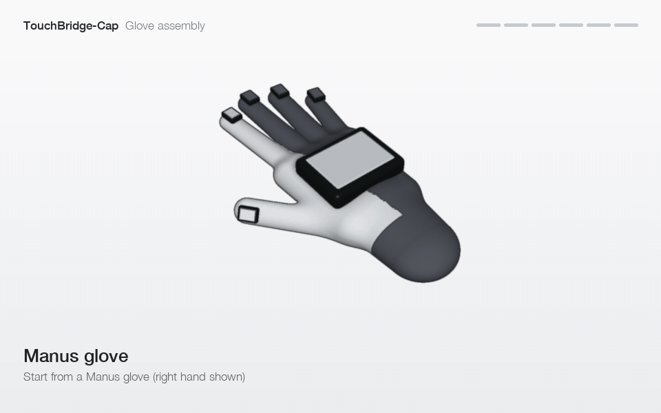

# Hardware

3D-printable parts for the TouchBridge-Cap data-collection glove and the matching
robot-side fingertip adapters.

## Glove (human side)

The glove is built on a Manus glove. Use the same parts on both hands, except for
part 2, which has a left and a right version.

| File | Qty per glove | Purpose |
|---|---|---|
| [`glove/fingertip_mount_thumb.stl`](glove/fingertip_mount_thumb.stl) | 1 | Clips onto the Manus thumb-tip module; holds a tactile sensor on its palm-side plate |
| [`glove/fingertip_mount_index.stl`](glove/fingertip_mount_index.stl) | 1 | Same, index finger |
| [`glove/fingertip_mount_middle.stl`](glove/fingertip_mount_middle.stl) | 1 | Same, middle finger |
| [`glove/fingertip_mount_ring.stl`](glove/fingertip_mount_ring.stl) | 1 | Same, ring finger |
| [`glove/fingertip_mount_pinky.stl`](glove/fingertip_mount_pinky.stl) | 1 | Same, little finger |
| [`glove/part1_back_of_hand_mount.stl`](glove/part1_back_of_hand_mount.stl) | 1 | Fits around the Manus hub on the back of the hand; carries the AprilTag cube and part 2 |
| [`glove/part2_wrist_camera_bracket_right.stl`](glove/part2_wrist_camera_bracket_right.stl) | 1 (right hand) | Bolts to the tabs of part 1 and holds the wrist camera |
| [`glove/part2_wrist_camera_bracket_left.stl`](glove/part2_wrist_camera_bracket_left.stl) | 1 (left hand) | Mirrored version of part 2 for the left hand |

Other items: five fingertip tactile sensors, one wrist camera, and one 46 mm
AprilTag cube with 40 mm tags (IDs 0–4 on the right hand, 5–9 on the left; see
`preprocess/cube_pose_detector.py`).

### Assembly

1. Clip a fingertip mount onto each Manus fingertip module.
2. Fix a tactile sensor on the palm-side plate of each mount.
3. Fit part 1 around the Manus hub on the back of the hand.
4. Fix the AprilTag cube on top of part 1.
5. Bolt part 2 to the tabs of part 1. Use the version that matches the hand.
6. Mount the wrist camera in the frame of part 2.

## Robot side

The robot uses the same tactile sensors. These adapters attach them to the Wuji
fingertips (see the hand model in [`assets/robot`](../assets/robot/README.md)).

| File | Qty per hand | Purpose |
|---|---|---|
| [`robot/fingertip_sensor_adapter_thumb.stl`](robot/fingertip_sensor_adapter_thumb.stl) | 1 | Wuji thumb tip ↔ tactile sensor |
| [`robot/fingertip_sensor_adapter_finger.stl`](robot/fingertip_sensor_adapter_finger.stl) | 4 | Wuji finger tip ↔ tactile sensor |

## Units

The STL files use different units. Check the scale when you import them into a slicer:

- `glove/*.stl` are exported in **metres**. Scale them by 1000 to get millimetres.
- `robot/*.stl` are exported in **millimetres**.
